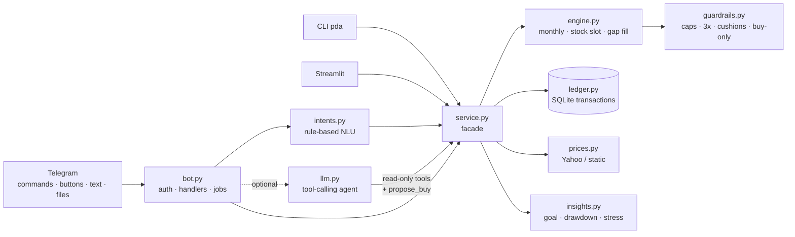

# 📈 Portfolio Deploy Agent

**A buy-only Telegram co-pilot that turns a written investing plan into a monthly buy list, enforces guardrails, keeps your holdings up to date, and talks you out of panic-selling.**

Free to run: Telegram bot API + Yahoo Finance + SQLite, plus an *optional* free LLM (Groq / Gemini / local Ollama).

```
 You (Telegram)                              Payday, 9:30 AM
 ─────────────                               ───────────────
 "📋 Plan"  ──────────────▶  🗓 Monthly buy list: $2,000
                             VOO    $750   ≈1.103 sh
                             SPCX   $400   ≈3.030 sh   ← stock slot: furthest below target
                             VHT    $250   ...
                             🛡 VOO is 1.3x QQQM (rule: ≥3x). $100 of QQQM moved to VOO.
                             [ ✅ I bought these ]  [ ⏭ Skip ]
 tap ✅  ─────────────────▶  📝 Bought, ledger updated
 "should I sell?" ────────▶  🛑 No selling. Here's what a bad year looks like on paper…
```

---

## The plan it enforces

| Bucket | Holdings | Share |
|---|---|---|
| Core ETFs | VOO 30%, QQQM 10% | 40% |
| Other ETFs | VHT 8%, SMH 6%, SCHD 2.8%, SPMO 2.4%, VXUS 0.8% | 20% |
| Gold | IAUM 8% | 8% |
| Stocks | BRK.B 7%, NVDA 5%, GOOGL 4%, DELL 3%, TSLA 2.5%, SPCX 2.5%, MSFT 2.5%, AMZN 2%, PLTR 1.5%, AMD 1%, LLY 0.6%, INTC 0.4% | 32% |

**Monthly $2,000:** VOO $650 · VHT $250 · BRK.B $200 · IAUM $200 · SMH $150 · QQQM $100 · SPMO $50 · **stock slot $400** → whichever of NVDA, GOOGL, SPCX, TSLA, MSFT, AMZN is furthest below its target.

**Guardrails (code, not suggestions):**
1. **VOO ≥ 3× QQQM.** QQQM's top holdings are already inside VOO. If a buy would break the ratio, the QQQM money goes to VOO.
2. **No single stock above 5%** of the portfolio *after* the buy. DELL is capped at 3% because your job already gives you Dell exposure. BRK.B is capped at its own 7% target, since it's a diversified holding company. Excess goes to VOO.
3. **VHT and BRK.B are the biggest non-AI buys.** Validated at startup and enforced on every plan.
4. **Never sell.** The engine has no sell output. `/sold` exists only to keep the ledger in sync with your broker, and it asks you to confirm.
5. **Rebalance only with new money.** Drift is closed by steering the monthly buys, the stock slot, and `/extra` cash.

Everything lives in [`config/strategy.yaml`](config/strategy.yaml), validated strictly at startup (targets = 100%, split = monthly amount, caps ≥ targets, cushions largest).

---

## Quick start (about 10 minutes)

```bash
git clone https://github.com/Nainil30/portfolio-deploy-agent && cd portfolio-deploy-agent
python -m venv .venv && source .venv/bin/activate      # Windows: .venv\Scripts\activate
pip install -e ".[dev]"
pda validate                       # checks strategy.yaml
pda --offline plan                 # try it with demo prices, no keys needed
```

**1. Create the bot.** In Telegram, message **@BotFather** → `/newbot` → copy the token.
**2. Configure.** `cp .env.example .env` and paste `TELEGRAM_BOT_TOKEN`.
**3. Run.** `pda bot`, then send `/start` to your bot. It replies with your chat id. Put it in `.env` as `TELEGRAM_CHAT_ID` and restart. From then on only your chat can use the bot.
**4. Load holdings.** In Fidelity: *Accounts & Trade → Portfolio → Positions → Download*. Send the CSV to the bot. (Or `cp config/holdings.example.yaml config/holdings.yaml`, edit it, and run `pda import config/holdings.yaml`.)
**5. Optional AI.** Get a free key at [console.groq.com](https://console.groq.com) and set `GROQ_API_KEY`. Without it, plain-English buy logging still works through the rule-based parser.

### Keeping it running for $0
| Option | How |
|---|---|
| Your PC | `pda bot` (Windows: Task Scheduler "At log on"; macOS/Linux: `tmux` or a systemd user service) |
| Always-free VM (Oracle Cloud, GCP e2-micro) or Raspberry Pi | `docker compose up -d`. The ledger is kept in `./data` |
| No always-on machine | Cron or Task Scheduler runs `pda send-plan` on payday. You record buys with the CLI, or open the bot when you're at your PC |

---

## Using it

| Command | What it does |
|---|---|
| `/plan [amount]` | This month's buy list with reasons + ✅ button (`/plan 3000` scales the split) |
| `/extra 5000` | Bonus / refund cash → fills the biggest gaps vs target |
| `/portfolio` · `/drift` | Value, buckets, AI exposure · every ticker vs target |
| `/guardrails` | ✅/⚠️ for each rule with the exact numbers |
| `/goal [monthly]` | Months to $155k at 4% / 7% / 10% |
| `/stress` | Paper loss in an AI sell-off, a bear market, or a correction |
| `/bought VOO 650 [@ 612.4]` · `/bought NVDA 2 sh` | Record a buy in $ or shares |
| `/history` · `/undo` | Audit trail; undo the last record **or import** |
| *send a .csv / .yaml* | Replace the ledger with your broker's positions |
| *free text* | "bought 400 of nvda", "got a 5k bonus", "how long to 155k?", "should I sell?" |

**Automatic messages:** your buy list on payday (`reminder_day`, skipped if already recorded). A "hold the line" message the first time the portfolio is 10/20/30% below its peak. A Sunday digest with a nudge if this month's buys aren't recorded yet.

The CLI mirrors everything: `pda plan`, `pda extra 5000`, `pda portfolio`, `pda guardrails`, `pda import file.csv`, `pda bought VOO 650`, `pda ask "…"`, etc. Add `--offline` for demo prices.

Optional dashboard: `pip install -e ".[dashboard]" && streamlit run dashboard/app.py`.

---

## Architecture



**Core idea: the rules decide and the LLM only explains.** Money math is pure, deterministic and unit-tested. The LLM can only call read-only tools or *propose* a buy that you confirm with a button.

```
src/pda/
  config.py      strategy.yaml → typed Strategy + strict validation
  models.py      dataclasses: Position, Snapshot, Plan, BuyLine, Adjustment
  prices.py      PriceProvider protocol; YahooPrices (cached, aliases) / StaticPrices
  ledger.py      append-only SQLite ledger; holdings are replayed from it; undo; imports
  portfolio.py   holdings + prices → Snapshot with drift
  engine.py      monthly_plan, pick_slot, extra_plan
  guardrails.py  apply_guardrails (moves money) + check_portfolio (status report)
  insights.py    months_to_goal, drawdown, stress_test
  importers.py   Fidelity CSV / YAML parsing
  intents.py     regex + keyword NLU (no key needed)
  llm.py         OpenAI-compatible tool-calling agent (Groq/Gemini/Ollama)
  formatting.py  Telegram HTML + plain-text rendering
  service.py     facade shared by bot, CLI, LLM tools and dashboard
  bot.py         python-telegram-bot v21: handlers, buttons, scheduled jobs
```

## Tests

```bash
pytest -q          # 77 tests, no network: engine, guardrails, ledger, parser, bot handlers, LLM loop
ruff check src tests
```

CI runs both on Python 3.11 and 3.12 for every push.

## How a month works, step by step

1. **On the 15th at 9:30 AM** the bot loads your holdings from the ledger and fetches live prices from Yahoo Finance.
2. **It builds the buy list.** It starts from the fixed split (VOO $650, VHT $250, and so on) and scales it if you ask for a different amount.
3. **It fills the stock slot.** The six candidates are ranked by how far each sits below its target. The $400 goes to the top one, as far as its cap allows; any leftover goes to the next, then to VOO.
4. **The guardrails run, in order:**
   - Clamp anything negative (buy-only).
   - Trim any stock that would pass its cap.
   - Move QQQM money to VOO if VOO would drop below 3× QQQM.
   - Keep VHT and BRK.B as the biggest non-AI buys.

   Every change becomes a one-line explanation in the message.
5. **You place the orders in Fidelity** and tap **✅ I bought these**. The bot records each buy at the current price, so your holdings stay accurate. Tapping twice can't double-count, and `/undo` reverses it.
6. **Each weekday after the market closes** the bot saves a snapshot. If the portfolio is newly 10/20/30% below its peak, it sends one calm "hold the line" message. On Sundays it sends a digest, with a nudge if the month's buys aren't recorded yet.
7. **Any time** you can ask for `/portfolio`, `/guardrails`, `/goal` or `/stress`, or just type "bought 400 of nvda" or "got a 5k bonus".

---

## What was done in v2, and why

v1 was a LangGraph pipeline that sent a daily Telegram push. A review of it turned up real bugs, so v2 is a ground-up rebuild around the written plan above.

| Area | v1 (before) | v2 (now) | Why it matters |
|---|---|---|---|
| Strategy | Category targets split evenly across tickers; dip-timing tranches (60/25/15) | Exact per-ticker targets, fixed $2k split + stock slot, from `strategy.yaml` | Matches the actual plan; no market timing |
| Validation | Loose (`enabled: true7` slipped through) | Strict: targets = 100%, split = budget, caps ≥ targets, cushions largest | A typo stops the bot instead of producing a wrong buy list |
| Guardrails | One cap, measured against the monthly budget | Caps on the post-buy portfolio, VOO ≥ 3× QQQM, DELL 3%, cushions, buy-only. Each one moves money and explains why | Enforces the rules from the plan |
| "Reflection" | A LangGraph loop that re-ran the same math, so it could never change the result | Removed; the guardrails are the real check | No fake agent steps |
| Holdings | Hand-edited YAML, so it went stale | Append-only SQLite ledger: ✅ button, `/bought`, Fidelity CSV import, `/undo` | One tap a month keeps everything accurate |
| State | GitHub Actions + SQLite reset every run, so the same tranche was re-sent daily | A long-running bot with a persistent DB (or `send-plan` for cron) | Reminders fire once, and "already done" is remembered |
| Telegram | Send-only plain text | Commands, buttons, keyboard, file upload, chat-id auth, scheduled jobs | A two-way assistant, not a notification |
| AI | Required Groq key; the LLM wrote a summary paragraph | Optional. Rule-based parser first, then a tool-calling LLM that can only read data or *propose* a buy | Free, grounded in real numbers, human-confirmed writes |
| Behaviour | None | Drawdown alerts, stress test, goal projection; "should I sell?" gets the stress test, not a sell signal | Protects against the biggest risk to the plan: panic-selling |
| Repo hygiene | Committed `.venv` (16k files), DB and personal holdings | All gitignored; secrets in `.env` | Fast clone, no personal data |
| Quality | A few tests that needed the network | 77 offline tests, ruff, CI on 3.11/3.12, Docker | Safe to change, easy to deploy |

### Bugs the tests caught during the rebuild
- **Cushion vs cap:** when BRK.B hit its 7% cap, the cushion rule also cut the gold buy down to BRK.B's reduced amount. Fixed: a cushion held back by its own cap no longer sets the floor.
- **Rounding:** QQQM's allowed buy of $37.50 rounded up to $38 and left VOO $2 short of 3×. Fixed: guardrail limits round *down*.

### A decision you should know about
Your plan targets **BRK.B at 7%**, which conflicts with "no single stock above 5%". Berkshire is a diversified holding company, so it has its own cap equal to its 7% target. To hold it to 5% instead, change `per_ticker_caps` in `config/strategy.yaml`, and lower its target to match; the startup check rejects any target above its cap.

For the interview version of all this (pitch, build steps, trade-offs, likely questions and a demo script), see **[docs/INTERVIEW_GUIDE.md](docs/INTERVIEW_GUIDE.md)**.

---

*Personal planning tool. Not financial advice. Market data from Yahoo Finance may be delayed.*
