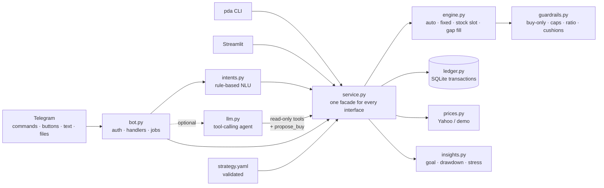

# 📈 Portfolio Deploy Agent

**Your investing plan, on autopilot in Telegram.** Tell it how much you invest each month, which stocks and ETFs you want (and in what %), and your money goal. Every payday it sends you exactly what to buy, explains why, enforces your rules, and keeps you from panic-selling when markets drop.

Free to run · works with any broker · any currency · any Yahoo Finance ticker (US, India, UK, Canada, Europe, crypto) · AI optional

[](https://github.com/Nainil30/portfolio-deploy-agent/actions/workflows/ci.yml)
  

---

## Contents
1. [Why this exists](#1-why-this-exists)
2. [What it looks like](#2-what-it-looks-like-no-install-needed) (no install needed)
3. [Features](#3-features)
4. [Quick start](#4-quick-start-5-minutes) (5 minutes)
5. [Make it your plan](#5-make-it-your-plan)
6. [Connect Telegram](#6-connect-telegram)
7. [Daily use](#7-daily-use)
8. [Run it 24/7 for free](#8-run-it-247-for-free)
9. [How it works](#9-how-it-works)
10. [Project structure](#10-project-structure)
11. [Testing & quality](#11-testing--quality)
12. [FAQ](#12-faq)
13. [Docs, roadmap, license](#13-docs-roadmap-license)

---

## 1. Why this exists

Most long-term investors don't fail because they picked the wrong ETF. They fail because they:
- **skip months** or don't know how to split this month's money,
- **let the portfolio drift** (one hot stock ends up at 15%),
- **sell in a crash** and lock in the loss.

Portfolio Deploy Agent turns a written plan into a habit. It does the math, applies your rules the same way every month, and when the market falls it reminds you what the plan says (*keep buying*) instead of letting fear decide.

> **Core design idea: the rules decide, the AI explains.** Every dollar amount comes from deterministic, unit-tested code. The optional LLM only answers questions using that code's output, and it can't record anything without your tap.

---

## 2. What it looks like (no install needed)

**Payday message** (the example "Core + stock slot" plan, $2,000/month):
```
🗓 Monthly buy list: $2,000
Portfolio: $42,491

VOO      $750  ≈1.103 sh
SPCX     $400  ≈3.030 sh
VHT      $250  ≈0.733 sh
BRK.B    $200  ≈0.350 sh
IAUM     $200  ≈4.938 sh
SMH      $150  ≈0.323 sh
SPMO      $50  ≈0.400 sh
Why
• VOO: Monthly split (+$100 redirected)
• SPCX: Stock slot: 0.0% vs 2.5% target (2.5 pts below, furthest below of 6 candidates)
• VHT … SPMO: Monthly split

🛡 Guardrails applied
• VOO is 1.3x QQQM (rule: at least 3x). $100 of the QQQM buy moved to VOO.

[ ✅ I bought these ]  [ ⏭ Skip ]
```

**The simplest plan** ("Three-fund", $500/month, starting from $0, auto mode):
```
🗓 Monthly buy list: $500
VTI      $300  ≈0.829 sh     • Gap fill: 0.0% vs 60% target
VXUS     $150  ≈1.854 sh     • Gap fill: 0.0% vs 30% target
BND       $50  ≈0.698 sh     • Gap fill: 0.0% vs 10% target
```

**`/guardrails`**: your rules checked against the real portfolio:
```
⚠️ Core ratio: VOO is only 1.3x QQQM (need 3x). QQQM buys go to VOO until about $15,504 more VOO is added.
⚠️ Position caps: Over cap: NVDA 8.4% (cap 5%), GOOGL 5.4% (cap 5%), DELL 5.0% (cap 3%).
   No new buys there. Don't sell: new money will shrink them over time.
✅ Never sell: 0 sells recorded. Keep it that way in a drop.
```

**`/goal`** and **`/stress`**:
```
🏁 Road to $155,000                       🌧 Stress test
Now: $42,491 · investing $2,000/mo        AI sell-off (2022-style)  -$11,605 (-27%)
   4%/yr → 49 mo (Dec 2030)               Broad bear market (-30%)  -$12,212 (-29%)
   7%/yr → 45 mo (Aug 2030)               In the worst case your $2,000 buys ~40% more shares.
  10%/yr → 41 mo (Apr 2030)               The plan in a drop: keep buying, don't sell.
```

**Chat like a person:**
```
You:  bought 400 of nvda          Bot: 📝 Recorded NVDA $400 (2.1164 sh @ $189.00). Wrong? /undo
You:  I got a 5k bonus            Bot: 💵 Extra-cash buy list: $5,000 (VHT $1,148, BRK.B $1,004, …)
You:  should I sell everything?   Bot: 🛑 No selling. That's the one rule the plan depends on. (+ stress test)
```

Want to see it live? `pda demo` prints the full tour with an example plan. No accounts or keys needed.

---

## 3. Features

| | Feature | What it does for you |
|---|---|---|
| 🗓 | **Monthly buy list** | Sent on your payday: exact amounts per ticker, approximate shares, and a reason for each line |
| 🎯 | **Two plan styles** | **Auto**: list your targets and new money always goes to what's furthest below target. **Fixed**: a written dollar split plus an optional "stock slot" |
| 🛡 | **Guardrails** (all optional) | Max % per stock, per-ticker caps (e.g. your employer's stock), "fund A ≥ N× fund B", defensive "cushion" funds, and **never sell** |
| 💵 | **Extra cash** | `/extra 5000`: a bonus or tax refund fills your biggest gaps first |
| ✅ | **One-tap tracking** | "I bought these" updates your holdings. Also `/bought`, `/undo`, and a broker CSV import |
| 🏁 | **Goal projection** | Months to your money goal at 4/7/10%/yr (or your own assumption) |
| 🧘 | **Hold-the-line alerts** | One calm message when you're 10/20/30% below your peak, plus a stress test on demand |
| ⚙️ | **Change settings from chat** | `/set monthly 3000`, `/set goal 250k`, `/set day 15` |
| 🤖 | **Optional AI** | Ask anything in plain English (free Groq/Gemini, or local Ollama). It's grounded in your real numbers and can never write without your confirmation |
| 🌍 | **Universal** | Any currency symbol, any timezone, any Yahoo ticker: `VOO`, `RELIANCE.NS`, `VOD.L`, `SHOP.TO`, `BTC-USD` |
| 🔒 | **Private** | Self-hosted: your holdings stay on your machine, and only your Telegram chat can talk to the bot |
| 💻 | **CLI + dashboard** | Everything also works from the terminal; there's an optional Streamlit dashboard |

---

## 4. Quick start (5 minutes)

**You need:** Python 3.11+ ([download](https://www.python.org/downloads/)) and Git. Telegram is only needed for the bot.

### Option A: one command
```bash
git clone https://github.com/Nainil30/portfolio-deploy-agent.git
cd portfolio-deploy-agent
bash scripts/setup.sh                                              # macOS / Linux
powershell -ExecutionPolicy Bypass -File scripts\setup.ps1         # Windows
```
This installs everything, shows a demo, runs the setup wizard for **your** plan, and checks your setup.

### Option B: step by step
```bash
git clone https://github.com/Nainil30/portfolio-deploy-agent.git
cd portfolio-deploy-agent
python -m venv .venv
source .venv/bin/activate          # Windows: .venv\Scripts\activate
pip install -e .
pda demo                           # 1. see it work (example plan, demo prices)
pda init                           # 2. create YOUR plan (about a minute of questions)
pda plan                           # 3. this month's buy list with live prices
pda doctor                         # 4. check everything, with fixes
```

---

## 5. Make it your plan

### The easy way: `pda init`
```
📈 Portfolio Deploy Agent: set up your plan

Name for your plan [My plan]: Retirement
Currency symbol [$]: €
How much do you invest each month? [1000]: 800
Your money goal (portfolio value to reach) [100000]: 300k
Yearly return to assume for projections, in % [7]: 6
Day of the month for your buy reminder (1–28) [1]: 10
Your timezone [America/New_York]: Europe/Berlin

Start from:
  1) Three-fund: VTI 60 / VXUS 30 / BND 10 (simplest)
  2) Dividend income: SCHD, VIG, VYM + a few dividend stocks
  3) Core + stock slot: S&P core, sector ETFs, gold, stocks, all guardrails
  4) India index (₹): Nifty 50, Next 50, Nasdaq 100, gold (NSE)
  5) Custom: type your own tickers and %
Choose [5]: 5

Enter your targets, one per line:  TICKER PERCENT [type]
  (0% so far) > VWCE.DE 70
  (70% so far) > AGGH.AS 20 bond
  (90% so far) > SAP.DE 10 stock
  (100% so far) >
Max % for any single stock (blank = no cap) [10]:

✅ Saved config/strategy.yaml
```
Targets that don't add up to 100% are scaled for you. Non-interactive use: `pda init --preset three_fund --monthly 500 --goal 100000 --yes`.

### Presets in [`examples/`](examples/)
| Preset | Style | Shows off |
|---|---|---|
| [`three_fund.yaml`](examples/three_fund.yaml) | auto, $500/mo | The minimum: 3 lines of targets |
| [`dividend_income.yaml`](examples/dividend_income.yaml) | auto, $1,000/mo | 5% stock cap, cushion funds |
| [`core_plus_stock_slot.yaml`](examples/core_plus_stock_slot.yaml) | fixed, $2,000/mo | Every guardrail: split, stock slot, core ratio, per-ticker caps |
| [`india_index.yaml`](examples/india_index.yaml) | auto, ₹25,000/mo | NSE tickers, ₹, Asia/Kolkata |

### The smallest valid plan
```yaml
goal:    { target_value: 100000 }
monthly: { amount: 500 }
targets: { VTI: 60, VXUS: 30, BND: 10 }
```
Everything else has sensible defaults. **Every field is documented in [docs/CONFIGURATION.md](docs/CONFIGURATION.md).** Run `pda validate` after editing; mistakes are reported in plain English.

### Load what you already own (optional)
```bash
pda import Portfolio_Positions.csv     # Fidelity, Schwab, Vanguard, Zerodha-style, or ticker,shares,avg_cost
pda import config/holdings.yaml        # see examples/holdings.example.yaml
```
Or just send the file to the bot. Starting from zero? Skip this; the plan works from $0.

---

## 6. Connect Telegram

1. In Telegram, open **@BotFather** → send `/newbot` → choose a name → copy the **token** (looks like `123456789:AA…`).
2. `cp .env.example .env` and paste it: `TELEGRAM_BOT_TOKEN=123456789:AA…`
3. Run `pda bot`, open your new bot in Telegram, and send **/start**. It replies with your **chat id**.
4. Add `TELEGRAM_CHAT_ID=<that number>` to `.env` and restart `pda bot`. Now only your chat can use it, and the payday, daily and weekly messages are switched on.
5. *(Optional AI)* Get a free key at [console.groq.com](https://console.groq.com) → `GROQ_API_KEY=…` in `.env`. Or use Gemini (`LLM_PROVIDER=gemini`, `GEMINI_API_KEY`) or fully local Ollama (`LLM_PROVIDER=ollama`).

`pda doctor` checks each of these steps and tells you exactly what's missing.

---

## 7. Daily use

| In Telegram | What happens |
|---|---|
| 📋 **Plan** / `/plan` / `/plan 3000` | This month's buy list (scaled if you invest a different amount) |
| ✅ **I bought these** | Records every line at the current price. It can't be recorded twice |
| `/extra 5000` or "got a 5k bonus" | One-off cash → biggest gaps first |
| 💼 **Portfolio** · 🎯 **Drift** | Value, gain, buckets vs target · every ticker vs target |
| 🛡 **Guardrails** | ✅/⚠️ for each of your rules, with numbers |
| 🏁 **Goal** · `/stress` | Months to your goal · bad-year scenarios |
| `/bought VOO 650` · `/bought NVDA 2 sh @ 180` | Record a buy by amount or shares |
| `/history` · `/undo` | Recent activity · undo the last record **or import** |
| ⚙️ **Settings** · `/set monthly 3000` · `/set goal 250k` · `/set day 15` · `/set reset` | View or change your plan from chat |
| *send a .csv / .yaml* | Replace holdings with your broker's numbers (undoable) |
| *anything else* | Rule-based parser first, then the AI assistant if configured |

**Automatic:** your buy list on your reminder day (skipped if already recorded) · a weekday after-close check that alerts only when a new drawdown level is crossed · a Sunday digest with a nudge if this month isn't done.

**The same from the terminal:** `pda plan`, `pda extra 5000`, `pda portfolio`, `pda drift`, `pda guardrails`, `pda goal`, `pda stress`, `pda bought VOO 650`, `pda history`, `pda undo`, `pda set monthly 3000`, `pda ask "…"`. Add `--offline` to use demo prices.

**Dashboard (optional):** `pip install -e ".[dashboard]"` then `streamlit run dashboard/app.py`.

---

## 8. Run it 24/7 for free

The bot uses Telegram long polling, so there's **no website, domain or open port** to set up. It just needs a machine that stays on.

| Where | How | Cost |
|---|---|---|
| **Your PC / laptop** | `pda bot` (Windows: Task Scheduler → "At log on"; macOS/Linux: `tmux`, or a `systemd --user` service) | $0 |
| **Raspberry Pi / old laptop** | `docker compose up -d` | $0 |
| **Always-free cloud VM** (Oracle Cloud Free Tier, Google Cloud e2-micro) | `git clone` → `pda init` → `docker compose up -d`. The ledger lives in `./data` | $0 |
| **Nothing always on** | Cron or Task Scheduler runs `pda send-plan` on payday; record buys with the CLI | $0 |

---

## 9. How it works



**One month, step by step:**
1. **Load:** read `strategy.yaml` (validated), apply any `/set` overrides, replay the ledger to get holdings, fetch prices (cached, with international symbol handling).
2. **Plan:**
   - *auto mode*: each ticker's shortfall vs target is measured *after* adding this month's money, and the money is split in proportion to those shortfalls.
   - *fixed mode*: the written split (scaled to the amount), then the stock slot goes to the candidate furthest below target.
3. **Guardrails, in order:** clamp negatives (buy-only) → trim anything that would pass its cap (measured on the post-buy portfolio) → keep "A ≥ N× B" → keep cushions the largest defensive buys. Freed money goes to your core fund, and each change becomes a one-line explanation.
4. **Finalize:** whole amounts, tiny orders folded into the core fund, and a total that exactly equals what you invest.
5. **You buy at your broker and tap ✅:** each line is recorded at the current price; plans can't be recorded twice; `/undo` reverts.
6. **Watch:** a daily snapshot. A drawdown is measured on unrealized gain, so deposits don't hide losses, and the alert fires once per level per peak.

**Why the AI can't hurt you:** it only gets tools that *read* (portfolio, plan, guardrails, goal, stress) plus `propose_buy`, which shows a confirm button. No tool sells, edits the config or deletes anything. Without an AI key, the rule-based parser handles the common messages, so the whole product works for $0.

A deeper walkthrough of how it's built, with the reasoning behind each decision, is in **[docs/HOW_IT_WORKS.md](docs/HOW_IT_WORKS.md)**.

---

## 10. Project structure

```
portfolio-deploy-agent/
├── src/pda/
│   ├── config.py       strategy.yaml → typed Strategy; strict validation; ticker normalization
│   ├── models.py       Position, Snapshot, Plan, BuyLine, Adjustment, RuleCheck
│   ├── money.py        currency formatting (₹, €, $ …)
│   ├── prices.py       PriceProvider protocol: YahooPrices (cached, intl. symbols) / StaticPrices
│   ├── ledger.py       append-only SQLite: transactions, plans, snapshots, alerts, settings
│   ├── portfolio.py    holdings + prices → Snapshot with drift
│   ├── engine.py       monthly_plan (auto/fixed), pick_slot, gap_fill, extra_plan
│   ├── guardrails.py   apply_guardrails (moves money) · check_portfolio (status)
│   ├── insights.py     goal projection · drawdown · stress test
│   ├── importers.py    broker CSV / YAML import
│   ├── intents.py      rule-based natural-language parsing (no key needed)
│   ├── llm.py          OpenAI-compatible tool-calling agent (Groq / Gemini / Ollama)
│   ├── onboarding.py   pda init (wizard) · pda demo · pda doctor
│   ├── formatting.py   Telegram HTML + plain-text output
│   ├── service.py      facade shared by bot, CLI, AI tools and dashboard
│   ├── bot.py          Telegram handlers, buttons, scheduled jobs
│   └── __main__.py     the `pda` CLI
├── examples/           preset plans + example holdings
├── config/             demo_prices.yaml (your strategy.yaml / holdings.yaml are gitignored here)
├── tests/              118 offline tests
├── dashboard/app.py    optional Streamlit dashboard
├── scripts/            one-command setup (setup.sh / setup.ps1)
├── docs/               CONFIGURATION · HOW_IT_WORKS · INTERVIEW_GUIDE · LINKEDIN_POST
├── Dockerfile · docker-compose.yml · .github/workflows/ci.yml
```

---

## 11. Testing & quality

```bash
pip install -e ".[dev]"
pytest -q                 # 118 tests, no network, ~3 seconds
ruff check src tests
```
What's covered:
- **Money invariants:** totals are exact, nothing is ever negative, and no capped ticker ends above its cap at any amount.
- **Each guardrail:** including how they interact (two real bugs were caught this way).
- **Auto and fixed modes**, and every preset.
- **The setup wizard**, driven with scripted answers.
- **The ledger:** undo, undo of an import, average-cost sells.
- **Parsers:** CSVs from several brokers, plain-English messages.
- **Telegram handlers**, driven with fake updates.
- **The AI tool loop**, tested with a scripted fake model. It proves that `propose_buy` never writes.

CI runs lint, validates every preset, runs the demo and runs the tests on Python 3.11 and 3.12.

---

## 12. FAQ

**Does it place trades?** No. It tells you what to buy; you place the orders at your broker. That's deliberate: there are no broker credentials and no risk of a runaway bot.

**Which brokers?** Any. Import accepts Fidelity, Schwab and Vanguard positions CSVs, Zerodha-style exports, or a simple `ticker,shares,avg_cost` file. You can also record buys by hand.

**Which countries and tickers?** Anything on Yahoo Finance: `RELIANCE.NS` (India), `VOD.L` (UK), `SHOP.TO` (Canada), `VWCE.DE` (Germany), `BTC-USD` (crypto). Set `profile.currency` to your symbol.

**Will it ever tell me to sell?** No. The engine has no sell output. `/sold` exists only to keep your records in sync if you already sold, and it asks you to confirm.

**What does it cost?** $0: Telegram's bot API, Yahoo Finance data, SQLite, and optional free AI tiers. Most messages never touch the AI.

**Where is my data?** On your machine: `data/pda.db` and `config/strategy.yaml`, both gitignored. Nothing is sent anywhere except price lookups (tickers only) and, if you enable it, your question to the AI provider you chose.

**Is this financial advice?** No. It's a tool that follows the plan *you* write. Do your own research.

---

## 13. Docs, roadmap, license

| Doc | For |
|---|---|
| [docs/CONFIGURATION.md](docs/CONFIGURATION.md) | Every field in `strategy.yaml`, with examples |
| [docs/HOW_IT_WORKS.md](docs/HOW_IT_WORKS.md) | Architecture and step-by-step build walkthrough |
| [docs/INTERVIEW_GUIDE.md](docs/INTERVIEW_GUIDE.md) | Presenting the project: pitch, decisions, Q&A |
| [docs/LINKEDIN_POST.md](docs/LINKEDIN_POST.md) | A ready-to-post announcement |

**Roadmap:** read-only brokerage sync · look-through exposure (NVDA inside VOO/QQQM) · multi-user hosted version · tax-lot tracking · an evaluation set for comparing AI providers.

MIT licensed. Contributions welcome: open an issue with your plan style or broker CSV format.

*Personal planning tool. Not financial advice. Market data from Yahoo Finance may be delayed.*
